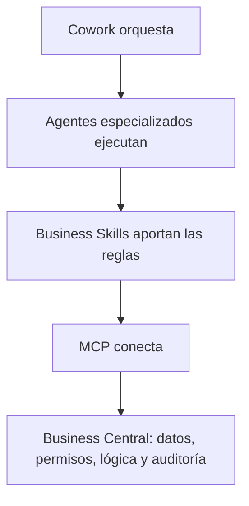

La semana pasada estuve en **Directions EMEA 2026**, en París (del 27 al 29 de octubre). Si tuviera que resumir el evento en una frase, sería esta: **Copilot en Business Central deja de ser un asistente que consulta y pasa a ser una pieza que actúa**, con agentes, reglas de negocio propias y un servidor MCP que lo conecta todo.

{: w="600" h="600" .shadow }
*Directions EMEA 2026 en París; acreditación y sala principal*

En este artículo recojo lo más relevante de lo que presentó Microsoft, ordenado por áreas, y al final mi lectura de qué significa para quienes implantamos y desarrollamos sobre Business Central.

> Las fechas de disponibilidad que aparecen en el artículo son las anunciadas en el evento. Microsoft suele ajustarlas, así que tómalas como orientativas y confírmalas en los release plans antes de comprometer nada con un cliente.
{: .prompt-warning }

## El punto de partida: mucha IA, poco valor

Microsoft abrió con unas cifras que, para mí, explican todo lo demás:

| Dato | Cifra |
| --- | --- |
| Organizaciones que ya usan IA | 90 % |
| Organizaciones que reportan valor significativo | 6 % |
| Organizaciones que usan Business Central | 55.000 |
| Nuevas funcionalidades en los últimos 12 meses | 160+ |

La distancia entre el 90 % y el 6 % es el mensaje. Casi todo el mundo está «usando IA», pero muy pocos la han convertido en resultados. Y la apuesta de Microsoft para cerrar esa brecha en el ERP pasa por que la IA trabaje **dentro del proceso**, con los datos, permisos y reglas del cliente, no al lado.

## Copilot ya edita el ERP

### Edit with Copilot

Es, probablemente, el cambio más visible. Con **Edit with Copilot** puedes crear, modificar y eliminar registros con una instrucción en lenguaje natural. En la demo se localizaba un pedido de venta y se cambiaba la fecha de entrega «al próximo lunes» sin tocar un solo campo a mano.

Lo importante no es la demo, sino lo que la acompaña: **cada cambio queda registrado** (qué cambió, cuándo y por qué). Sin esa trazabilidad, ningún responsable de sistemas dejaría a Copilot modificar datos de producción. Arranca en acceso anticipado para partners.

### El nuevo Copilot

El nuevo Copilot combina datos de Business Central con correos, mensajes de Teams, archivos e información externa de la web, y permite elegir el modelo de IA más adecuado para cada tarea. La demo cruzaba el inventario con fuentes externas (como Maersk) para evaluar el impacto de disrupciones de transporte en Europa.

> Copilot **hereda los permisos del usuario**: no puede tocar nada que el usuario no pueda tocar. Es el argumento que vas a necesitar en cualquier conversación con el cliente sobre seguridad, y conviene que lo tengas claro desde el principio.
{: .prompt-info }

## Business Skills: el conocimiento del negocio, dentro de Copilot

Para mí, es la novedad más disruptiva de todo el evento y la que más recorrido va a tener en proyectos. La razón: todo aquello de lo que llevamos tiempo hablando en el mundo del desarrollo (instrucciones, skills, agentes que siguen reglas definidas) **ahora llega a los consultores**, dentro de Business Central y sin escribir una línea de código.

Las **Business Skills** permiten enseñar a Copilot y a los agentes tres cosas:

- **Tu conocimiento**: terminología, contexto y experiencia.
- **Tus reglas**: políticas, condiciones y recomendaciones.
- **Tus procesos**: cómo debe hacerse realmente el trabajo.

Cada skill es un registro editable en una página propia de Business Central y se aplica a todas las compañías. En la demo se vieron skills de lanzamiento de producto, incorporación de empleados, gestión de devoluciones o confirmación de presupuestos y su conversión en pedido.

El ejemplo que mejor lo explica: al crear un presupuesto a partir de un email, el agente añade **solo** el catálogo que exige el procedimiento interno. No es Copilot «adivinando», es Copilot aplicando una regla que alguien del negocio ha escrito.

El acceso anticipado para partners se anunció para las próximas semanas.

## Agentes: los de Microsoft y los tuyos

### Expense Agent

El agente de gastos está en vista previa pública y tiene prevista la disponibilidad general en diciembre de 2026. Captura tickets y recibos, infiere la divisa, detecta posibles incumplimientos de la política de gastos, agrupa los recibos en informes y los envía a aprobación. Lo más destacado de esta versión:

| Área | Ya disponible (oct–nov 2026) | Disponibilidad general (dic 2026) |
| --- | --- | --- |
| Captura | App móvil, kilometraje, asignación a proyectos, detección de duplicados, recibos perdidos | Tarjeta de crédito, gastos de pequeño importe sin adjunto |
| Informes | Reembolso automático por email, dietas y solicitudes de viaje | La IA añade participantes, límites de gasto |
| Aprobación | Validación de políticas con IA, aprobadores interinos y delegación | Aprobación de solicitudes de viaje, políticas por categoría |
| Cumplimiento | Retenciones sobre gastos, reclamación de IVA en informes | Actualización de role centers |

### Sales Order Agent y Payables Agent

Mejoras más incrementales, pero muy prácticas:

- **Sales Order Agent**: onboarding más sencillo, varios agentes en la misma compañía, búsqueda de artículos por variante y mejor vista de disponibilidad.
- **Payables Agent**: conciliación con pedidos de compra, recepción en factura, visor de PDF en facturas de compra, revisión por email y abonos.

### Agentes personalizados

Aquí está el salto de fondo. Microsoft presentó los **agentes personalizados de Business Central** como «unidades gestionadas de ejecución de procesos»:

- **Se diseñan en lenguaje natural, sin código**, se prueban en sandbox y tienen instrucciones versionadas y logs de resolución de problemas.
- **Seguros por diseño**: identidad propia, permisos asignados y el modelo de seguridad de BC.
- **Auditables**: línea de tiempo, registro de razonamiento, revisión humana y marca de «creado/modificado por» un agente.
- **Desplegables a escala**: disparadores definidos, empaquetado en apps y despliegue entre entornos.
- Funcionan con apps PTE e ISV y **consumen créditos de Copilot**.

El empaquetado en apps es lo que convierte esto en algo serio para un partner: un agente deja de ser una configuración frágil y pasa a tener el mismo ciclo de vida que una extensión.

## Servidor MCP de Business Central

Si llevas tiempo siguiendo el blog, sabes que el MCP de Business Central me interesa especialmente (lo probé conectándolo con Claude en un [artículo anterior](/mi-bc-copilot-blog/posts/conectar-mcp-server-business-central-claude/)). En Directions se presentó como la pieza que une todo:

- **APIs a medida**: exponen páginas y consultas de API de BC como herramientas para que los agentes lean y modifiquen registros, además de ejecutar acciones de negocio.
- **Herramientas genéricas de consulta de datos**: los agentes pueden descubrir tablas, entender su esquema y relaciones, y consultar datos que ninguna API expone, siempre con los permisos del usuario conectado. Consumen créditos de Copilot.
- **Herramientas de agentes**: permiten descubrir los agentes personalizados de BC, encargarles tareas y seguir su progreso. Vista previa para partners en noviembre–diciembre de 2026.

Todo ello se organiza en torno a cuatro verbos de gobierno: **descubrir** (entornos, empresas, APIs), **consultar** (agregaciones en la capa de datos), **controlar** (limitar herramientas, empresas y entornos) y **gobernar** (permisos y auditoría en BC).

La arquitectura por capas que dibujó Microsoft es la que yo usaría para explicárselo a un cliente:

El mismo servidor MCP sirve al trabajo **personal y ad hoc** (Copilot Chat y Cowork) y al trabajo **organizacional y repetible** (Copilot Studio en low-code y AI Foundry en pro-code). Es decir, lo que un usuario prueba hoy en un chat puede acabar siendo mañana un proceso automatizado sin cambiar de conector.

## Business Central en Cowork y replicación en Fabric

- **BC en Cowork**: acceso anticipado para partners en noviembre–diciembre de 2026, en entornos sandbox, para construir y probar bucles agénticos complejos antes de desplegarlos. La idea es clara: *Chat* para asistir, *Cowork* para delegar.
- **Replicación en Fabric**: vista previa pública en noviembre. Datos en tiempo casi real hacia el entorno de analítica, sin APIs intermedias y con configuración en tres pasos. Para muchos proyectos de reporting esto simplifica bastante la integración actual.

## Plataforma, administración y desarrollo

### Master data management entre entornos

Hasta ahora, compartir datos maestros funcionaba entre compañías **dentro de un mismo entorno**. Ahora se amplía a **varios entornos**: un único dataset maestro que alimenta compañías en entornos distintos. Para grupos con entornos separados por país o por línea de negocio, es una mejora muy esperada.

### Campos de extensión almacenados en la tabla base

Un cambio de plataforma que no se ve, pero se nota. La evolución del almacenamiento de campos de extensión:

| Versión | Modelo | Coste |
| --- | --- | --- |
| Antes de v23 | Una tabla por extensión | Joins N-way |
| v23 | Una tabla `$ext` compartida | Un único join |
| v29 | Campos almacenados en línea en la tabla base | Sin joins |

De N joins a uno y, ahora, a ninguno. En tablas muy extendidas (clientes, artículos, líneas de venta) esto debería traducirse en mejor rendimiento sin que tengas que tocar tu código AL.

### Page scripting ya es GA

La herramienta de grabación de recorridos de usuario alcanza la disponibilidad general, ya localizada: sin código AL, con generación de scripts asistida por IA, soporte de selección múltiple en cuadrículas y validación de textos en mensajes y diálogos de error. Es la forma más rápida de tener **pruebas de aceptación reproducibles** que el propio usuario clave puede mantener.

### Novedades para administradores

- Gestión completa del ciclo de vida de apps PTE desde el Admin Center.
- Despliegue más rápido de hotfixes de apps de Microsoft.
- Sandbox con configuración igual a producción y mejoras en la exportación de bases de datos.
- Un **Admin MCP** para la administración.
- Cifras compartidas: unas 800 operaciones de «Restore deleted environment» al mes, el 99 % de envíos al marketplace validados en menos de 30 minutos y un 82 % de mejora de velocidad.

### Customize with Copilot

Acceso anticipado para partners en enero de 2027. La propuesta: prototipar la personalización **mientras se discute la necesidad** con el cliente. Lo que me tranquiliza es el planteamiento: el resultado **es solo una extensión**, se integra en tu proceso de ingeniería y está gobernado por permisos. No es una vía paralela de personalizar fuera de control.

## Implantación asistida por IA

Una de las demos que más me interesaron conectaba todo el ciclo de implantación: requisitos, mapeo a BC, configuración, pruebas, documentación y validación.

| Qué automatiza la IA | Qué aporta la skill | Qué conserva el consultor |
| --- | --- | --- |
| Lectura de correos y documentos, propuesta de setup y generación de evidencias | Reglas de configuración, documentación y pruebas | Diseño, criterio, validación y responsabilidad sobre el resultado |

Esa tercera columna es la que importa. La IA acelera el trabajo mecánico, pero la responsabilidad sobre lo que se entrega sigue siendo nuestra.

En la parte de desarrollo se mencionaron además herramientas como **OptimAL**, **BCQuality integrado con AL-Go** y la automatización con MCP y CLI, en la línea de reforzar calidad y rendimiento con IA.

## Licencias: qué viene incluido y qué se paga por uso

Una de las preguntas que más se repitieron en los pasillos fue cuánto cuesta todo esto. Microsoft lo resumió en tres formas de monetizar la IA en Business Central, con una única moneda para todo lo que se paga por uso:

{: w="1200" h="568" .shadow }
*Las tres formas de monetizar la IA en Business Central; una única moneda, los créditos de Copilot*

1. **Integración con Copilot y Cowork**: Copilot en Business Central viene con la licencia de BC; Cowork se paga por uso.
2. **Agentes de Microsoft (first-party) y MCP**: por tarea o por llamada, en créditos de Copilot.
3. **Agentes de terceros (partners e ISV) y funcionalidades de IA en extensiones**: por uso, en créditos de Copilot.

> **Una sola moneda: 1 crédito de Copilot = 0,01 USD.** Simplifica mucho explicárselo al cliente: da igual si el consumo viene de un agente de Microsoft, de una app de ISV o del MCP, todo se mide en créditos.
{: .prompt-info }

### Copilot y Cowork en Business Central

El primero de esos tres bloques se detalló así:

{: w="1200" h="546" .shadow }
*Copilot y Cowork en Business Central; qué entra en la licencia y qué se paga por uso*

| Funcionalidad | Modelo | Qué incluye |
| --- | --- | --- |
| Copilot en BC (chat) | Incluido en la licencia de BC | Respuestas de solo lectura sobre los datos de Business Central. El contexto de Work IQ (correo, reuniones, archivos) requiere licencia de Microsoft Copilot |
| Edit with Copilot | Incluido en la licencia de BC | Crear y actualizar registros desde la interfaz de BC. Provisional, solo en acceso anticipado y sujeto a cambios |
| Business Central + Cowork | Por uso, con créditos de Copilot | Trabajo largo y multipaso entre BC y Microsoft 365. Requiere licencia de Microsoft Copilot para el acceso y una política de gasto para el consumo. Las llamadas a BC a través del servidor MCP costarán 0,001 USD (0,1 créditos) cada una |

La lectura práctica: **consultar y editar desde Business Central entra en la licencia** (en el caso de la edición, a falta de confirmación definitiva), mientras que **delegar trabajo en Cowork se paga por consumo**. Es una frontera fácil de trasladar al cliente, aunque el precio por llamada obliga a estimar volúmenes antes de diseñar procesos agénticos intensivos.

### Agentes de Microsoft y servidor MCP

El segundo bloque puso cifras a los agentes de Microsoft, que es justo lo que necesitas para hacer un primer cálculo de coste con un cliente:

{: w="1200" h="614" .shadow }
*Coste orientativo de los agentes de Microsoft y del servidor MCP en Business Central*

| Agente o servicio | Coste orientativo | Unidad |
| --- | --- | --- |
| Payables Agent | 0,75 USD | Por factura de compra (media de 5 líneas) |
| Sales Order Agent | 0,20 USD | Por email típico |
| Expense Agent | 0,50 USD | Por recibo |
| Servidor MCP | 0,001 USD (0,1 créditos) | Por llamada al endpoint MCP; se monetizará próximamente |

> Las cifras de los agentes son **cálculos de ejemplo**: Microsoft dejó claro que el precio real puede variar según el cliente y el escenario. Úsalas para dimensionar, no para presupuestar al céntimo.
{: .prompt-warning }

Con estos números, el análisis de negocio empieza a ser concreto. Por ejemplo, un cliente que recibe 1.000 facturas de compra al mes estaría en torno a 750 USD mensuales con el Payables Agent, y esa es la cifra que hay que comparar con el tiempo que hoy dedica administración a registrarlas.

> Para este caso concreto, conviene no perder de vista el mercado: existen herramientas de terceros como **Document Capture** de Continia que, hoy por hoy, ofrecen más funcionalidad en la captura y registro de documentos y resultan más económicas. El Payables Agent es una opción interesante, pero no es automáticamente la mejor para todos los clientes; compara antes de recomendarlo.
{: .prompt-info }

### Agentes personalizados y funcionalidades de IA en extensiones

El tercer bloque es el que más nos afecta como partners, porque aplica a los agentes que construyamos nosotros:

{: w="1200" h="528" .shadow }
*Monetización de los agentes personalizados creados por partners e ISV*

- Los **agentes personalizados** se construyen con el framework de agentes de Business Central y se distribuyen en extensiones.
- Se facturan **por uso en créditos de Copilot**, con cargo a la política de gasto del cliente, igual que los agentes de Microsoft.
- El coste de referencia es de **2 créditos de Copilot por paso** (0,02 USD).
- **Los ISV son responsables de monetizar sus propios agentes**: Microsoft cobra el consumo; lo que el ISV quiera cobrar por su agente va aparte.

> Al diseñar un agente personalizado, el número de pasos pasa a ser una variable de coste. Un proceso bien acotado, con instrucciones claras y Business Skills que eviten pasos innecesarios, no solo funciona mejor: también sale más barato.
{: .prompt-tip }

### Bundle BC + Copilot Business

Microsoft anunció una propuesta conjunta para simplificar la adopción de Copilot en clientes de Business Central:

| Bundle | Precio de lista anunciado |
| --- | --- |
| Essentials + Copilot Business | 95 USD por usuario/mes |
| Premium + Copilot Business | 125 USD por usuario/mes |

Los precios definitivos en euros llegarán con la lista de precios de diciembre de 2026, y la compra vía CSP está anunciada para enero de 2027.

> El bundle cubre la licencia, no el consumo. Cuando dimensiones una propuesta, separa siempre **licencia (usuarios)** y **consumo (créditos de Copilot)**; es lo que más dudas genera en el cliente.
{: .prompt-tip }

## Roadmap 2026–2027

Este fue el roadmap de Copilot en Business Central que Microsoft mostró en la keynote:

{: w="1200" h="900" .shadow }
*Roadmap de Copilot en Business Central presentado en Directions EMEA 2026*

Lo completo con el resto de hitos que se anunciaron en otras sesiones:

| Fecha | Hito | Novedades |
| --- | --- | --- |
| Octubre 2026 | Wave 2 · Directions | Copilot en BC (vista previa pública) · Edit with Copilot (acceso anticipado partners) |
| Noviembre–diciembre 2026 | Ignite | Business Skills, BC en Cowork y herramientas MCP de agentes (acceso anticipado partners) · Expense Agent con tarjeta de crédito e identificación de participantes por IA |
| Enero 2027 | — | Copilot en BC (disponibilidad general) · BC en Cowork (vista previa pública) · Customize with Copilot (acceso anticipado partners) |
| Abril 2027 | Wave 1 | Edit with Copilot, Edit BC en Cowork, agentes de BC (1P/3P) en Cowork y Business Skills (vista previa pública) · **Autopilot**: procesos continuos, bandeja de entrada y acciones sugeridas |
| Junio 2027 | Normativa | Sostenibilidad: reporting obligatorio para grupos de micro y pequeñas empresas |

## Mi lectura: qué cambia en nuestro trabajo

Salgo de París con la sensación de que el foco ya no está en «qué puede hacer Copilot», sino en **cómo se gobierna**: permisos heredados, trazabilidad de cada cambio, agentes con identidad propia, skills editables y un MCP con capacidad de limitar herramientas, empresas y entornos. Es justo lo que faltaba para llevar esto a producción con clientes reales.

Hasta ahora hemos hablado mucho de cómo la IA ha cambiado el día a día de los desarrolladores. Lo que me llevo de Directions es que **ese cambio ya ha llegado a la consultoría**: las mismas ideas que han transformado cómo programamos (darle contexto a la IA, escribirle reglas, delegarle tareas repetitivas) pasan ahora a manos del consultor, dentro de Business Central.

En la práctica, en consultoría, Business Skills, Page Scripting y la implantación asistida por IA cambian cómo documentamos, configuramos y validamos. En desarrollo, Customize with Copilot, los agentes empaquetados en apps y el MCP abren una forma nueva de extender Business Central que sigue respetando el ciclo de vida de siempre.

Mi recomendación práctica:

1. **Empieza por las Business Skills** en cuanto tengas acceso. Escribir las reglas del negocio de un cliente es trabajo de consultor, no de desarrollador, y es lo que va a marcar la diferencia entre un agente útil y uno genérico.
2. **Prepara un sandbox** para probar BC en Cowork y las herramientas de agentes del MCP antes de que lleguen a vista previa pública.
3. **Revisa el modelo de licencias y créditos** con tus clientes antes de diciembre, cuando lleguen los precios en euros del bundle.
4. **Mete Page Scripting en tus UAT** desde ya: es GA, no necesita código y te deja una batería de pruebas reutilizable para cada actualización.

La brecha entre el 90 % que usa IA y el 6 % que obtiene valor no se cierra con más funcionalidades, sino con buenas implantaciones. Y ahí, el papel del partner sigue siendo el mismo de siempre: entender el negocio y traducirlo en un sistema que funcione.
