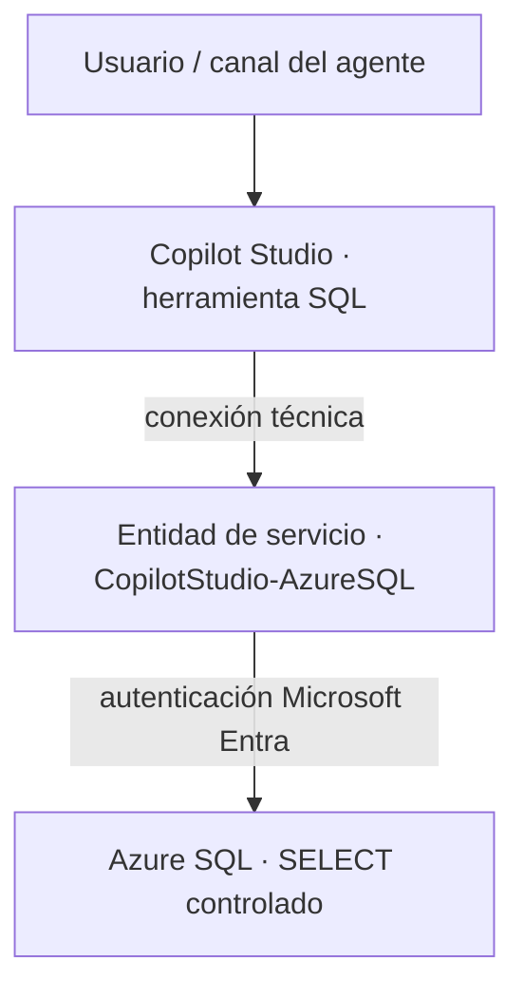

Estos días estoy montando el prototipo de un agente de Copilot Studio para un cliente, y una de sus piezas es consultar datos que viven en una base de datos Azure SQL. Conectar un agente a Azure SQL no consiste solo en añadir el conector SQL Server como herramienta. Antes hay que preparar Azure y Microsoft Entra: la red del servidor, una identidad con la que el agente se autentique y los permisos de esa identidad dentro de la base. Y, ya en Copilot Studio, hay que decidir qué parte de la llamada se deja en manos de la IA y qué parte queda fija.

En este artículo te cuento cómo lo he configurado para que el agente ejecute **una consulta definida y controlada**, usando una **identidad técnica** de Microsoft Entra en lugar de las credenciales de cada usuario. También recojo los errores que aparecen por el camino, porque se repiten en cualquier configuración parecida.

## El objetivo: una consulta controlada, no SQL libre

La arquitectura que buscaba es esta:



Y estas son las decisiones que la sostienen:

| Decisión | Motivo |
| --- | --- |
| Conector SQL Server → **Ejecutar una consulta SQL (V2)** | Ejecutar una consulta concreta, nada más |
| **Entidad de servicio** de Microsoft Entra | Identidad no personal, que no depende de un usuario |
| Servidor y base con valor **Personalizado** | Evitar que el agente intente *List the databases* |
| Permisos SQL de **solo lectura** sobre objetos concretos | Mínimo privilegio |
| Nada de SQL generado libremente por el modelo | Riesgo e imprevisibilidad |

### Por qué una herramienta y no conocimiento

Azure SQL también se puede añadir como **conocimiento** del agente, pero no es lo que necesito. En mi caso el agente va a ejecutar **consultas SQL específicas**, definidas de antemano: no tiene que descubrir qué tablas hay ni decidir dónde buscar la respuesta. Para eso encaja mejor la herramienta *Ejecutar una consulta SQL (V2)*, con servidor, base y consulta fijos.

Tampoco uso las credenciales de cada usuario final: las consultas son siempre las mismas y se ejecutan con una identidad técnica de solo lectura.

> El conector SQL Server es **Premium** en Copilot Studio. Antes de empezar, comprueba licencias, capacidad y políticas DLP del entorno de Power Platform.
{: .prompt-info }

## Fase A: preparar Azure SQL y la red

Antes de tocar Copilot Studio, conviene dejar la base de datos accesible y verificada. Si algo falla aquí, el error aparecerá después en el agente y será mucho más difícil de diagnosticar.

1. **Confirma servidor y base.** En la *Información general* de la base, copia el FQDN completo del servidor (`<servidor>.database.windows.net`) y el nombre de la base, y comprueba que la base está **Online**. Si es *serverless* y estaba en pausa, espera a que se reanude.
2. **Configura el administrador de Microsoft Entra.** En el recurso **SQL server** (no en la base), ve a *Configuración → Microsoft Entra ID → Establecer administrador*. Mejor un grupo administrado que una cuenta personal. Sin este paso no podrás crear usuarios de Entra dentro de la base.
3. **Abre la red para la prueba.** En *Redes*, selecciona **Redes seleccionadas** y activa la excepción **Permitir que los servicios y recursos de Azure accedan a este servidor**.

{: w="2000" h="1127" .shadow }
*Configuración de red usada para la validación funcional.*

> Esa excepción abre el servidor a cualquier servicio dentro del perímetro de Azure, no solo a tu tenant. La autenticación y los permisos SQL siguen siendo obligatorios, pero la exposición de red es mayor. Úsala para validar, con la aprobación del cliente, y revisa antes de producción opciones más restrictivas compatibles con el conector.
{: .prompt-warning }

Para cerrar la fase, abre el **Editor de consultas** de la base con **Autenticación de Microsoft Entra** (no con autenticación SQL), entrando con la cuenta administradora, y ejecuta:

```sql
SELECT SUSER_SNAME() AS UsuarioActual;
SELECT DB_NAME() AS BaseActual;
```

Si devuelve tu identidad y la base correcta, puedes seguir.

## Fase B: la identidad técnica en Entra y en la base

### Registrar la aplicación

En *Microsoft Entra ID → Registros de aplicaciones → Nuevo registro*:

- Nombre: `CopilotStudio-AzureSQL`.
- Tipos de cuenta: solo cuentas de este directorio organizativo.
- URI de redirección: vacío.

De la *Información general* de la aplicación necesitarás dos valores. Cuidado de no confundirlos con el *Identificador de objeto*:

| Campo en Copilot Studio | Campo en Microsoft Entra |
| --- | --- |
| Inquilino / Tenant | Id. de directorio (inquilino) |
| Id. de cliente / Client ID | Id. de aplicación (cliente) |

Después, en *Certificados y secretos → Nuevo secreto de cliente*, crea un secreto con la duración que permita la política del cliente y copia **el Valor**, no el *Id. del secreto*. Solo se muestra una vez.

> No pegues el secreto en actas, tickets, documentos ni chats. Guárdalo en un almacén seguro y anota quién es el responsable y cuándo caduca. Si se ha expuesto, elimínalo y genera uno nuevo.
{: .prompt-danger }

### Crear el usuario en la base y darle el mínimo permiso

Conectado al Editor de consultas como administrador de Entra, crea el usuario contenido a partir de la aplicación:

```sql
CREATE USER [CopilotStudio-AzureSQL] FROM EXTERNAL PROVIDER;
```

Para los permisos tienes dos caminos. Si solo quieres validar rápido, da lectura sobre toda la base:

```sql
ALTER ROLE db_datareader ADD MEMBER [CopilotStudio-AzureSQL];
```

Para producción, te recomiendo conceder `SELECT` solo sobre la vista o las tablas que use la consulta:

```sql
GRANT SELECT ON OBJECT::dbo.vw_Copilot_Facturas TO [CopilotStudio-AzureSQL];
```

Y comprueba lo que realmente tiene concedido:

```sql
SELECT p.name, p.type_desc, perm.permission_name, perm.state_desc
FROM sys.database_principals AS p
LEFT JOIN sys.database_permissions AS perm
    ON perm.grantee_principal_id = p.principal_id
WHERE p.name = N'CopilotStudio-AzureSQL';
```

Nada de `db_owner`, DDL ni escritura si el caso de uso es de consulta.

## Fase C: conexión y herramienta en Copilot Studio

### La acción correcta y el tipo de autenticación

En el agente, *Herramientas → Agregar una herramienta → SQL Server → **Ejecutar una consulta SQL (V2)***. No añadas *List the databases*: no necesitas que el agente descubra nada.

Al crear la conexión, el desplegable *Tipo de autenticación* ofrece varias opciones. La que buscamos es **Entidad de servicio (aplicación Microsoft Entra ID)**:

{: w="1353" h="852" .shadow }
*Microsoft Entra ID Integrated depende del usuario; Autenticación de SQL Server, de un usuario y contraseña SQL. Ninguna encaja en un diseño app-to-app.*

En el formulario se rellenan **Inquilino**, **Id. de cliente** y **Secreto de cliente** con los valores de la fase B. Ponle a la conexión un nombre operativo y reconocible, y comprueba después en la configuración de conexiones del agente que su estado es **Conectado**.

{: w="1215" h="885" .shadow }
*Conexión mediante entidad de servicio.*

Si la conexión la ha creado otro maker, asegúrate de que tiene el permiso **Puede usar y compartir** (*Can use + share*).

### Autenticación del autor, no del usuario final

Este es el punto que más fácilmente se pasa por alto. En los detalles de la herramienta, la **Autenticación** viene como *Cuenta de usuario final*. Con una entidad de servicio hay que cambiarla a **Autenticación del autor del agente** (*Agent author authentication*) y vincularla a la conexión técnica.

Si se deja en *Cuenta de usuario final*, a cada usuario se le podría pedir que cree su propia conexión, y el diseño app-to-app se rompe.

> Si la política del entorno bloquea el uso de credenciales del autor, habla con el administrador de Power Platform para revisar las opciones de credenciales del maker, o replantea el diseño hacia autenticación de usuario.
{: .prompt-tip }

### Servidor y base fijos

Si dejas el servidor y la base en **Rellenar con IA**, el modelo decide por su cuenta cómo llegar a los datos. En una de las pruebas, con el servidor puesto solo con su nombre corto, sin `.database.windows.net`, pedí «lista las facturas» y el agente optó por descubrir primero las bases de datos del servidor:

{: w="1011" h="785" .shadow }
*El agente llama a List the databases con el nombre corto del servidor y la operación acaba en timeout a los 60 segundos.*

La solución es quitarle esa decisión. En **Entradas**, cambia **Nombre del servidor** y **Nombre de la base de datos** de *Rellenar con IA* a **Personalizado**, con el FQDN completo y el nombre de la base:

{: w="1163" h="840" .shadow }
*Servidor con FQDN y base como valores personalizados. En la captura la autenticación aún aparece como Cuenta de usuario final; hay que cambiarla a la del autor.*

Dos detalles:

- Usa siempre el nombre completo `*.database.windows.net`, nunca solo el nombre corto del servidor.
- El aviso *No se han podido cargar las opciones* no impide escribir el nombre de la base a mano.

## Fase D: la consulta y las pruebas

### Fijar la consulta

En *Parámetros opcionales*, activa **Consulta** (*Query*), cámbiala también a **Personalizado** y pega un `SELECT` validado por el propietario del dato. Para la primera prueba, una consulta sin parámetros y con `TOP` para limitar el volumen:

```sql
SELECT TOP (10) *
FROM dbo.FacturasClientes;
```

Una vez validada la conexión, pasa a la consulta definitiva, sin `SELECT *` y solo con las columnas necesarias.

### Si la consulta necesita datos del usuario

Es la tentación habitual: dejar que el agente meta el nombre del cliente en el `WHERE`. Si lo haces concatenando texto libre, abres la puerta a la inyección SQL.

```sql
SELECT TOP (50) NumeroFactura, Cliente, FechaVencimiento, ImportePendiente
FROM dbo.vw_Copilot_Facturas
WHERE Cliente = @Cliente
ORDER BY FechaVencimiento;
```

- Define `@Cliente` como parámetro formal. *Ejecutar una consulta SQL (V2)* los admite: indicas el nombre y el tipo SQL (por ejemplo, `NVARCHAR(255)`) y aparece un campo para el valor, que es lo único que debe rellenar el agente.
- Si necesitas un `IN`, cada valor va en su propio parámetro (`IN (@ClienteA, @ClienteB)`), no en uno solo con valores separados por comas.
- La IA no debe poder tocar `SELECT`, `FROM`, `JOIN`, `ORDER BY` ni nombres de objetos.
- Los filtros por empresa u organización van en SQL, no solo en el prompt.

### Una descripción que acote al agente

La descripción de la herramienta es lo que lee el modelo para decidir cuándo usarla. Conviene ser explícito:

```text
Ejecuta una consulta SQL de solo lectura y previamente definida sobre
la base <nombre-de-la-base>. Úsala únicamente para consultar facturas
cuando estén disponibles los parámetros obligatorios. No inventes
servidor, base, tablas ni SQL alternativo.
```

### Qué comprobar en el panel de prueba

Con servidor, base y consulta fijos, el agente ya no explora el servidor y devuelve los datos:

{: w="1266" h="842" .shadow }
*El agente devuelve las 10 facturas de la tabla de prueba `FacturasClientes`, con datos ficticios.*

Que aparezcan datos no basta. Abre la tarjeta de la llamada a la herramienta y revisa:

| Validación | Valor esperado |
| --- | --- |
| Conexión | Conectado, sin pedir login al usuario final |
| Operación | *Ejecutar una consulta SQL (V2)*, nunca *List the databases* |
| `server` | FQDN completo, valor fijo |
| `database` | Nombre de la base, valor fijo |
| `query` | Exactamente el SQL autorizado |
| Respuesta | Datos esperados, sin información no autorizada |

Antes de publicar el agente, repite la prueba con un caso con datos y otro sin resultados.

## Errores habituales y cómo resolverlos

| Síntoma | Causa probable | Qué hacer |
| --- | --- | --- |
| *Database ... is not currently available* | Base serverless pausada o reanudándose | Esperar a que esté Online y reintentar |
| *Public access is disabled* | Bloqueo de red | Revisar *Redes* del SQL server |
| Te autentica, pero no tienes acceso a la base | Administrador de Entra mal configurado o base equivocada | Revisar el administrador, cerrar sesión y volver a conectar |
| *Principal not found* en `CREATE USER` | Nombre de la app o tenant incorrecto | Validar tenant, nombre y administrador del servidor |
| Timeout en *List the databases* | Servidor sin FQDN o campos en *Rellenar con IA* | Fijar FQDN y base como Personalizado |
| Conexión caducada | Secreto caducado | Rotar el secreto y reautenticar la conexión |

Un consejo con el primer error: no toques credenciales hasta descartar el estado de la base. Es tentador pensar que es un problema de permisos cuando la base simplemente está despertando.

## Antes de llevarlo a producción

Que funcione en el prototipo no significa que esté listo para producción. Lo que revisaría siempre:

- **Mínimo privilegio real.** Sustituir `db_datareader` por `GRANT SELECT` sobre una vista específica para Copilot, solo con las columnas necesarias.
- **Quién usa el agente.** Con autenticación del autor, todos los usuarios autorizados del agente consultan con el alcance de la identidad técnica. Microsoft la plantea para accesos implícitos o de bajo riesgo; si unos usuarios no deben ver datos de otros, o filtras en SQL o pasas a autenticación de usuario.
- **Red.** Sustituir la excepción de servicios de Azure por una opción más restrictiva que sea compatible con el conector y con las políticas del cliente.
- **Auditoría.** Activar auditoría y alertas en Azure SQL para consultas anómalas o errores repetidos.
- **Operación.** Responsable de la aplicación y de la rotación del secreto, alertas antes de su caducidad, y una conexión cuyo propietario no sea una persona que pueda dejar la empresa.

## Conclusión

Más allá de la configuración previa en Azure y Entra, la clave de este caso está en **quitarle decisiones al modelo**. Con todo en *Rellenar con IA*, el agente se pone a explorar el servidor; con servidor, base y consulta fijos, se convierte en una pieza predecible que solo hace lo que el propietario del dato ha aprobado.

Si vas a montar algo parecido, te recomiendo empezar así: una identidad técnica con permisos de solo lectura sobre una vista concreta, autenticación del autor, servidor y base fijos y una consulta cerrada. Una vez que eso funciona y está auditado, ya habrá tiempo de añadir parámetros tipados.

## Enlaces de interés

- [Conector SQL Server: operaciones, autenticación y límites](https://learn.microsoft.com/es-es/connectors/sql/)
- [Configurar la autenticación de Microsoft Entra con Azure SQL](https://learn.microsoft.com/es-es/azure/azure-sql/database/authentication-aad-configure?view=azuresql)
- [Entidades de servicio de Microsoft Entra con Azure SQL](https://learn.microsoft.com/es-es/azure/azure-sql/database/authentication-aad-service-principal?view=azuresql)
- [Controles de acceso de red de Azure SQL](https://learn.microsoft.com/es-es/azure/azure-sql/database/network-access-controls-overview?view=azuresql)
- [Autenticación del usuario final y del autor en las herramientas de Copilot Studio](https://learn.microsoft.com/es-es/microsoft-copilot-studio/configure-enduser-authentication)
- [Administrar las conexiones de un agente en Copilot Studio](https://learn.microsoft.com/es-es/microsoft-copilot-studio/authoring-connections)
